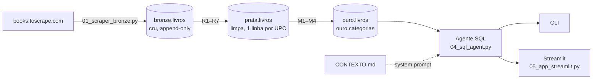

# 📚 Livraria Inteligente · Agente SQL

Pergunte em português, receba o número certo.

Um pipeline de dados **bronze → prata → ouro** no Supabase, alimentado por scraping do catálogo do [books.toscrape.com](https://books.toscrape.com), e um **agente SQL com LLM** que transforma perguntas de negócio em consultas. A interface em **Streamlit** mostra cada passo: o SQL gerado, o resultado do banco e a resposta final.

> Projeto da disciplina **Engenharia de Contexto Aplicada a Dados** (pós em Engenharia de Dados, Xperium). A ideia central: o agente acerta porque recebe **contexto de negócio**, não só o schema.

---

## Exemplo

> **❓ Qual categoria tem o maior valor em estoque, em reais?**

```sql
SELECT categoria,
       valor_estoque_gbp,
       ROUND(valor_estoque_gbp * 7.20, 2) AS valor_estoque_brl
FROM ouro.categorias
WHERE categoria <> 'Sem categoria'
ORDER BY valor_estoque_gbp DESC
LIMIT 1;
```

| categoria  | valor_estoque_gbp | valor_estoque_brl |
|------------|------------------:|------------------:|
| Nonfiction |          32123.26 |         231287.47 |

> 💬 **Nonfiction** é a categoria com o maior valor em estoque: **R$ 231.287,47** (£32.123,26 ao câmbio fixo de £1 = R$ 7,20). O ranking exclui "Sem categoria", conforme a regra M4.

Repare que nada disso está escrito na pergunta: o câmbio, a exclusão de "Sem categoria" e o uso da view `ouro.categorias` vêm do [CONTEXTO.md](download/CONTEXTO.md).

---

## Arquitetura



| Camada | O que é | Como é feita |
|---|---|---|
| **Bronze** | HTML extraído exatamente como veio (`£51.77`, `star-rating Three`, `In stock (22 available)`) | Tabela `jsonb`, append-only. Cada execução insere de novo |
| **Prata** | Um livro por UPC, tipado e limpo | View SQL aplicando as regras R1–R7 |
| **Ouro** | Métricas prontas para o negócio | Views SQL com as métricas M1–M4 |

Prata e ouro são **views em SQL puro**: sem ORM, sem pandas, sempre atualizadas. Cada linha que aplica uma regra de negócio leva um comentário `-- R<n>` ou `-- M<n>`, para dar rastreabilidade.

---

## O agente SQL

A cada execução, o system prompt é montado com:

1. **Instruções do agente:** papel, só `prata` e `ouro`, um `SELECT` por vez, perguntar se a pergunta for ambígua e recusar assuntos fora da livraria.
2. **O [CONTEXTO.md](download/CONTEXTO.md) inteiro**, lido do disco: regras de negócio, métricas, dicionário de dados e decisões.
3. **O schema real** de `prata` e `ouro`, lido do `information_schema`.

### Guardrails

| Proteção | Como |
|---|---|
| Só leitura | Aceita apenas `SELECT`/`WITH`, em transação `read only` |
| Um comando por vez | Rejeita SQL com mais de uma instrução |
| Bronze proibida | Bloqueia qualquer referência a `bronze.` |
| Custo controlado | `statement_timeout` de 10 s e `limit 50` |
| Autocorreção | Até 3 tentativas; o erro do banco volta para o LLM corrigir |

### Com e sem contexto

A flag `--sem-contexto` (ou o botão na barra lateral do Streamlit) tira o CONTEXTO.md e entrega ao agente o schema de **todas** as tabelas, inclusive a bronze. É a comparação feita em aula: sem contexto, o agente não sabe o câmbio, nem o que é "bem avaliado", e pode contar livros duplicados.

---

## Resultados

Com o contexto ligado, o agente acertou as 4 perguntas do [PRD](download/PRD.md). Cada resposta foi conferida com consultas diretas no banco:

| Pergunta | Resposta |
|---|---|
| Qual categoria tem o maior valor em estoque, em reais? | Nonfiction, **R$ 231.287,47** |
| Quantos livros bem avaliados custam menos de £20? | **75** |
| Quantos livros únicos temos na base? | **1.000** |
| Qual o preço médio por faixa de preço? | até £20: **£14,80** · £20–40: **£30,06** · acima de £40: **£49,91** |

Nenhuma consulta tocou a bronze.

---

## Como rodar

### Pré-requisitos

- Python 3.11+
- Um projeto no [Supabase](https://supabase.com) (o plano gratuito basta)
- Uma chave da API da [Anthropic](https://console.anthropic.com) ou da [OpenAI](https://platform.openai.com)

### 1. Instalar e configurar

```bash
git clone https://github.com/rodrigues-luan/livraria-inteligente-sql-agent.git
cd livraria-inteligente-sql-agent
pip install -r requirements.txt
cp .env.exemplo .env
```

Preencha o `.env`:

```ini
# Supabase > Connect > Session pooler (URI)
DATABASE_URL=postgresql://postgres.<project_ref>:<senha>@aws-0-<regiao>.pooler.supabase.com:5432/postgres

LLM_PROVIDER=anthropic          # ou openai
LLM_MODEL=claude-opus-5-5
ANTHROPIC_API_KEY=sk-ant-...
```

### 2. Montar as camadas

```bash
python 01_scraper_bronze.py                # 50 páginas = 1.000 livros (use --paginas 2 para testar)
python aplicar_sql.py sql/01_prata.sql
python aplicar_sql.py sql/02_ouro.sql
```

Tudo é idempotente: dá para rodar de novo sem quebrar nada. O scraper cria a tabela bronze se ela não existir.

### 3. Perguntar

**Interface web:**

```bash
streamlit run 05_app_streamlit.py
```

**Terminal:**

```bash
python 04_sql_agent.py                                    # modo interativo
python 04_sql_agent.py --pergunta "Qual o livro mais caro?"
python 04_sql_agent.py --sem-contexto                     # comparação sem contexto
```

**Consultas avulsas no banco:**

```bash
python aplicar_sql.py --query "select * from ouro.categorias order by valor_estoque_gbp desc limit 5"
```

---

## Estrutura

```
├── 01_scraper_bronze.py   # scraping paralelo (8 threads) → bronze.livros
├── aplicar_sql.py         # aplica arquivos .sql e roda consultas
├── 04_sql_agent.py        # agente SQL (CLI) + função perguntar() reutilizável
├── 05_app_streamlit.py    # interface web
├── sql/
│   ├── 00_bronze.sql      # tabela bronze
│   ├── 01_prata.sql       # view prata.livros (R1–R7)
│   └── 02_ouro.sql        # views ouro.livros e ouro.categorias (M1–M4)
├── download/
│   ├── PRD.md             # o problema e as perguntas que o produto precisa responder
│   ├── SPEC.md            # como construir, etapa por etapa
│   ├── CONTEXTO.md        # memória viva: regras, métricas, dicionário, decisões
│   └── AGENTS.md          # regras para agentes de código que trabalham no repo
└── requirements.txt
```

---

## Engenharia de contexto: os 4 documentos

O projeto foi construído com agentes de código (Claude Code) guiados por quatro arquivos Markdown, cada um com uma função:

| Documento | Responde | Quem escreve |
|---|---|---|
| [PRD.md](download/PRD.md) | **Por quê** e **o quê**: problema, usuários, escopo, métricas de sucesso | Humano |
| [CONTEXTO.md](download/CONTEXTO.md) | **As regras do negócio**: limpeza (R1–R7), métricas (M1–M4), dicionário, decisões | Humano, atualizado a cada etapa |
| [SPEC.md](download/SPEC.md) | **Como**: entregas e critérios de aceite de cada etapa | IA a partir do PRD, revisada pelo humano |
| [AGENTS.md](download/AGENTS.md) | **Regras da casa**: stack, convenções, o que é proibido | Humano com IA |

Em caso de conflito vale **CONTEXTO > SPEC > PRD**. O CONTEXTO.md tem dois usos: guia o agente de código durante o desenvolvimento e vira o system prompt do agente SQL em produção.

---

## Stack

Python · `requests` · `beautifulsoup4` · `psycopg` 3 · `python-dotenv` · `anthropic` / `openai` · `streamlit` · PostgreSQL (Supabase)

---

## Fora do escopo

- **Histórico de preços (SCD2):** a prata guarda só a versão mais recente de cada livro.
- **Agendamento:** o scraper roda sob demanda.
- **Vendas:** o site de origem não tem esses dados.

Os dados vêm do [books.toscrape.com](https://books.toscrape.com), um site fictício feito para treinar scraping. Preços e estoques não são reais, e o câmbio de R$ 7,20 é um valor fictício definido para a aula.
